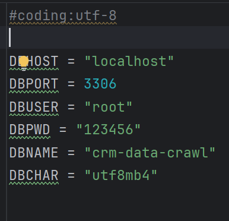
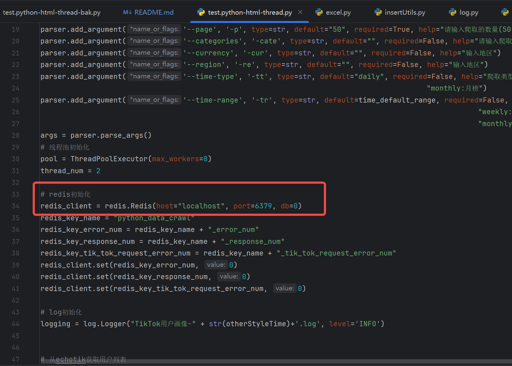

运行命令 
``python test.python-html-thread.py -p=[爬取数量,12倍数] -cur=[地区编码]D -re=[地区编码]``

例如：
``python test.python-html-thread-bak.py -p=12 -cur=USD -re=US``

数据配置在 ``Config.py``:

redis配置在启动类 ``test.python-html-thread.py``:

sql数据库编码utf8mb4文件在 ``sql\crm-python-data-crawl.sql``

